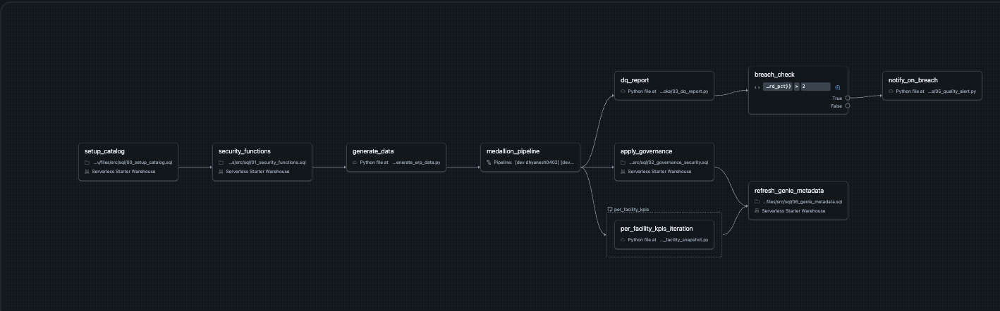
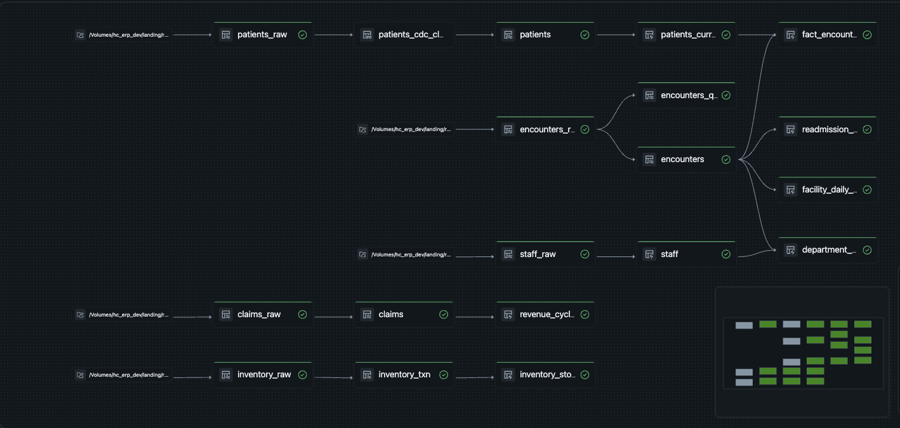
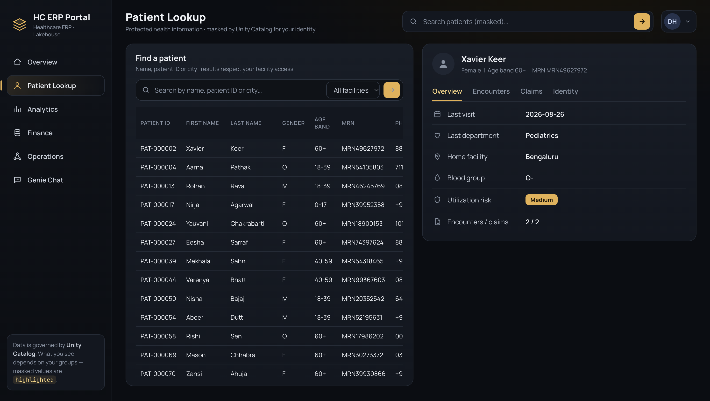
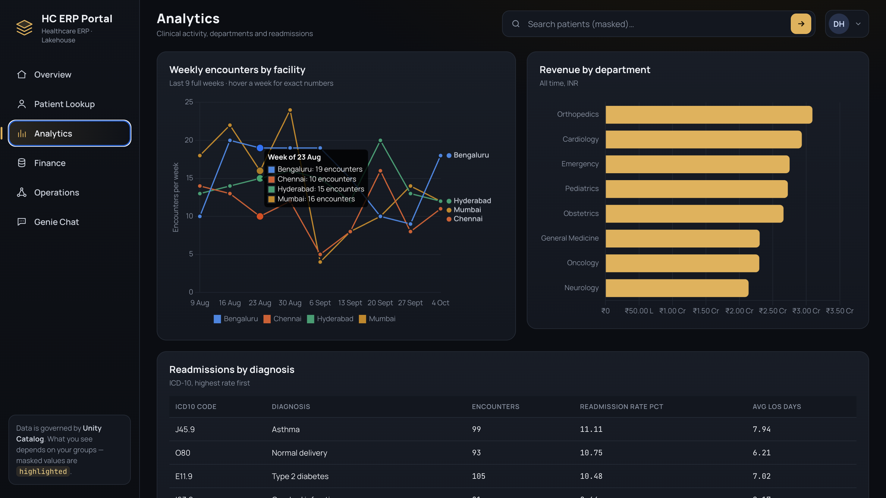
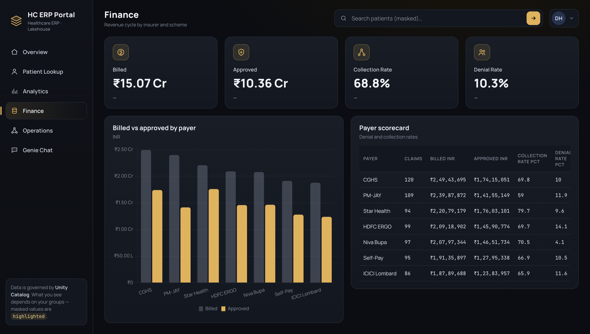
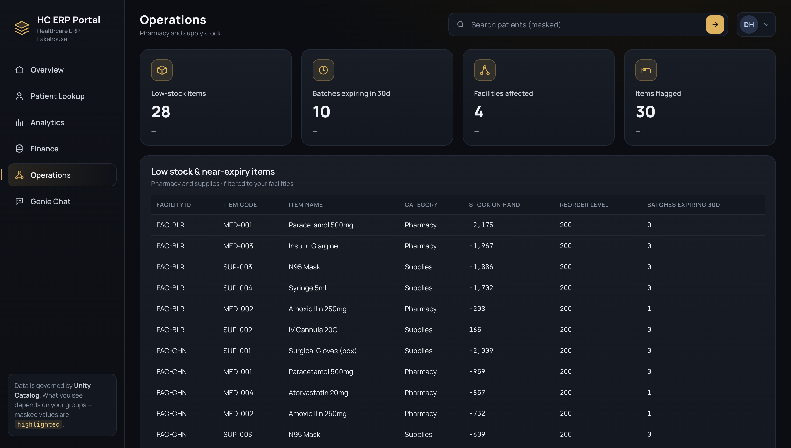
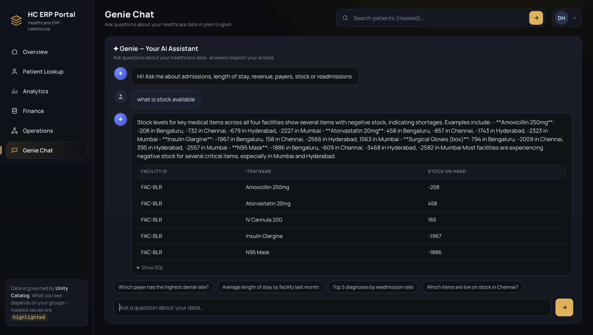

# MediCore Healthcare ERP Lakehouse on Databricks

End-to-end healthcare ERP lakehouse: Unity Catalog governance, PHI masking and row-level
security, Lakeflow Spark Declarative Pipelines (SDP / DLT) medallion architecture, a
multi-task Lakeflow Job, a Genie space, and a Databricks App web portal — all deployed
with one Asset Bundle.

**New to Databricks? Start with [`docs/BEGINNER_GUIDE.md`](docs/BEGINNER_GUIDE.md).**

## What it looks like

All data shown is synthetic (generated with Faker) — no real patient information.

### Orchestration — multi-task Lakeflow Job
Catalog setup → security functions → data generation → medallion pipeline, then a
data-quality report with an if/else breach check, governance, a for-each per-facility
KPI task and a Genie metadata refresh.



### Medallion pipeline — bronze → silver → gold
Raw landing files flow through cleansed silver tables (CDC / SCD2 for patients,
quarantine for bad encounters) into gold marts.



### Databricks App portal
The portal queries gold tables on behalf of the signed-in user, so Unity Catalog
column masks and row filters decide what each viewer sees.

**Patient Lookup** — PHI masked by Unity Catalog for the viewer's identity



**Analytics** — weekly encounters by facility, revenue by department and readmissions by diagnosis



**Finance** — revenue cycle by payer



**Operations** — low-stock and near-expiry pharmacy and supply items



**Genie Chat** — plain-English questions answered from the governed gold tables



## Quick start
```bash
databricks auth login --host https://<workspace>
# replace the <YOUR_...> placeholders in databricks.yml, resources/app.yml and app/app.yaml
databricks bundle validate -t dev
databricks bundle deploy   -t dev
databricks bundle run hc_erp_end_to_end -t dev   # data + pipeline + governance
databricks bundle run hc_erp_portal     -t dev   # website
```

## Feature map
| Requirement | Where |
|---|---|
| Jobs & tasks (SQL, Python, Pipeline, For-each, If/else, task values) | `resources/jobs.yml` |
| Medallion (bronze/silver/gold) | `src/pipelines/*` |
| DLT (`import dlt`) | `src/pipelines/bronze/bronze_ingest.py` |
| SDP (`from pyspark import pipelines as dp`), AUTO CDC SCD2, expectations, quarantine | `src/pipelines/silver/silver_cleanse.py` |
| SQL materialized views | `src/pipelines/gold/gold_marts.sql` |
| Data masking (column masks) & row filters | `src/sql/01_security_functions.sql` + `MASK`/`ROW FILTER` in pipeline schemas |
| Governance: tags, grants, audit | `src/sql/02_governance_security.sql` |
| Genie space | `genie/` + `src/sql/06_genie_metadata.sql` |
| Frontend website (Databricks App, on-behalf-of-user auth) | `app/` |
